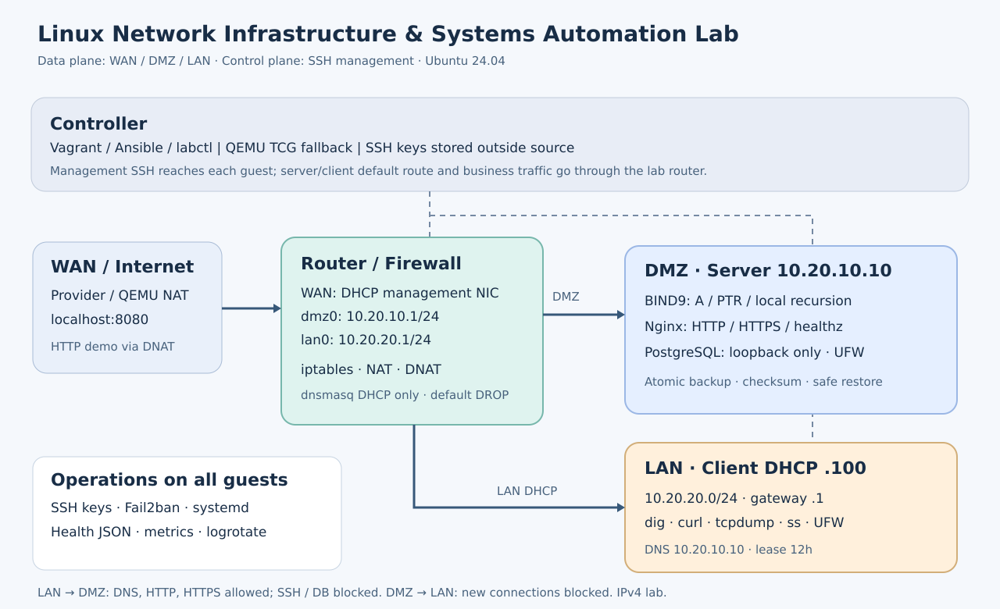

# Linux Network Infrastructure & Systems Automation Lab

Đồ án thực hành của **Đinh Tuấn Duy**: xây dựng hạ tầng Linux gồm router, máy chủ dịch vụ trong DMZ và máy khách trong LAN; tự động cấu hình bằng Vagrant + Ansible, kiểm tra sức khỏe, sao lưu và khôi phục PostgreSQL.



## Chạy nhanh

Controller Linux cần Python, Vagrant và **VirtualBox**, tối thiểu 8 GB RAM và khoảng 12 GB đĩa trống. Guest dùng Ubuntu 24.04. Xem [hướng dẫn cài đặt](docs/SETUP.md) cho libvirt hoặc kiểm thử bằng Docker.

```bash
./labctl bootstrap
./labctl doctor
./labctl up
./labctl verify
curl http://127.0.0.1:8080/healthz
./labctl ssh client
```

Máy thiếu VirtualBox/KVM có thể chạy VM thật bằng mô phỏng QEMU:

```bash
LAB_PROVIDER=qemu ./labctl up
./labctl verify
./labctl reboot
```

Chế độ QEMU cấp tổng2 GB RAM và giữ disk trong `.lab/qemu`; boot/provision chậm hơn do mô phỏng CPU.

`up` tạo cả ba VM rồi chạy Ansible theo thứ tự router → server → client. Các lệnh firewall và Netplan nằm trong guest; không chạy các file policy trực tiếp trên máy cá nhân. Web demo đi qua Vagrant port forward và DNAT của router.

## Thành phần

| Máy | Mạng lab | Chức năng |
|---|---|---|
| router | DMZ `10.20.10.1/24`, LAN `10.20.20.1/24`, WAN DHCP | dnsmasq DHCP, iptables ingress/egress, NAT, DNAT |
| server | DMZ `10.20.10.10/24` | BIND9 forward/reverse DNS, Nginx HTTP/TLS, PostgreSQL local, UFW |
| client | LAN DHCP reservation `10.20.20.100/24` | dig/curl/tcpdump/ss, kiểm chứng firewall và DNS/DHCP |

Cả ba máy có SSH bằng khóa, tài khoản operator, Fail2ban, health timer, log JSON và logrotate. Server có backup timer lúc 02:00 theo múi giờ Asia/Ho_Chi_Minh, retention 7 ngày và khôi phục sang database mới có tiền tố `lab_restore_`.

## Kiểm chứng

Nghiệm thu thực tế ngày14/10/2026: **34/34 regression**, **21/21 integration**, **3 VM QEMU**, kiểm tra lại sau reboot và failure drills đều PASS. Xem [biên bản nghiệm thu](artifacts/ACCEPTANCE.md) và [kết quả VM](artifacts/vm-results.json). VirtualBox/libvirt có cấu hình; runtime của hai provider này chưa được nghiệm thu trên máy hiện tại.

```bash
./labctl test          # Regression tests, render, Ansible syntax, Ruby, ShellCheck
./labctl integration   # Cần Docker: tạo mạng/container riêng, kiểm thử rồi tự dọn
./labctl verify        # Cần 3 VM đang chạy: dịch vụ, route, DHCP lease, restore, DNAT
./labctl reboot        # Reboot lần lượt rồi verify lại
./labctl drills        # Dừng dịch vụ, kiểm tra alert/backup failure, phục hồi, logrotate
./labctl report        # Cần Pandoc + XeLaTeX: sinh báo cáo PDF từ tài liệu + kết quả thật
```

Kết quả chạy được lưu trong [artifacts](artifacts). Kiểm thử container dùng cùng template với Ansible và kiểm tra gói tin thật; chu trình khởi động VM, Netplan apply, systemd timer và reboot được kiểm chứng bằng checklist VM trong [VALIDATION.md](docs/VALIDATION.md). Không suy ra các bước VM đã chạy từ kết quả container.

## Tài liệu bàn giao

| Tài liệu | Nội dung |
|---|---|
| [SETUP.md](docs/SETUP.md) | Cài controller, provider, chạy và dừng lab |
| [ARCHITECTURE.md](docs/ARCHITECTURE.md) | IP plan, luồng gói tin, chính sách firewall, phạm vi |
| [RUNBOOK.md](docs/RUNBOOK.md) | SOP DNS/DHCP/SSH/firewall, backup/restore, alert |
| [DEMO.md](docs/DEMO.md) | Kịch bản bảo vệ, xử lý sự cố và câu hỏi thường gặp |
| [VALIDATION.md](docs/VALIDATION.md) | Ma trận yêu cầu, kiểm thử và giới hạn xác minh |
| [BAO_CAO.md](docs/BAO_CAO.md) | Báo cáo đồ án tiếng Việt; nguồn tạo PDF |
| [SLIDES.md](docs/SLIDES.md) | Dàn bài trình bày 12 slide |
| [PRESENTATION.md](docs/PRESENTATION.md) | Nội dung slide hoàn chỉnh để xuất PDF |
| [TIMELINE.md](docs/TIMELINE.md) | Lộ trình 30 ngày dùng để dựng lại lịch sử Git |

Bản xuất: [báo cáo PDF](artifacts/bao-cao-do-an.pdf), [slide PDF](artifacts/slides-bao-ve.pdf), [gói source](artifacts/network-infra-project.zip).

PDF/ZIP là file xuất tại máy và được bỏ qua trong Git; tạo lại bằng `./labctl report` và `python3 scripts/package.py`. Lịch sử commit được dựng lại theo [timeline 15/09–14/10/2026](docs/TIMELINE.md); kết quả nghiệm thu giữ ngày thực tế 14/10/2026.

## Quản lý lab

```bash
./labctl provision     # Áp dụng lại cấu hình; không reset dữ liệu demo
./labctl halt          # Dừng VM và giữ dữ liệu
./labctl destroy       # Xóa các VM của dự án cùng dữ liệu trong guest
```

Khóa riêng của lab nằm trong `.lab/keys/`, không đóng gói hoặc đưa lên Git. Tài khoản `vagrant` giữ quyền quản trị để Ansible có thể provision; `operator` chỉ có các lệnh xem trạng thái được chỉ định. TLS self-signed dùng cho lab, máy khách kiểm chứng bằng `--cacert`.
