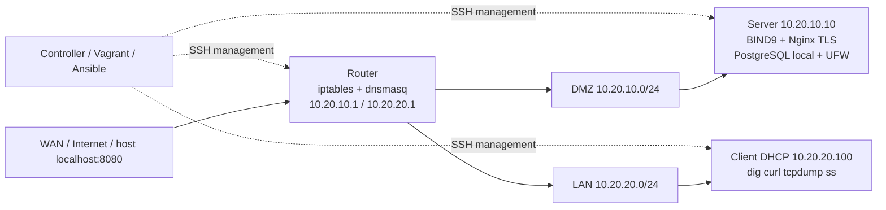

# Thiết kế hạ tầng

## Mục tiêu và ranh giới

Tạo lab tái lập để chứng minh năng lực quản trị Ubuntu, DNS/DHCP, phân đoạn mạng, firewall, điều tra sự cố và tự động hóa vận hành. Hệ thống mô phỏng một tổ chức nhỏ với máy chủ dịch vụ trong DMZ và người dùng trong LAN. Phạm vi là IPv4, một router và một server; chưa có HA, VLAN trunk vật lý, VPN, IDS/IPS hoặc backup offsite.

## Sơ đồ

Hai mạng lab là hai broadcast domains riêng, không phải hai VLAN trên một trunk. DHCP broadcast chỉ xuất hiện trong LAN. Management là mặt phẳng điều khiển, có thể vào SSH; traffic nghiệp vụ đi qua LAN/DMZ. Với VirtualBox, mỗi management NIC dùng NAT; với libvirt, cả ba nằm trong management bridge NAT.

## IP plan

| Segment | Địa chỉ / cấp phát | Gateway | DNS |
|---|---|---|---|
| DMZ | `10.20.10.0/24`; router `.1`, server `.10` | `10.20.10.1` | `10.20.10.10` |
| LAN | `10.20.20.0/24`; DHCP `.100–.150`, lease 12h | `10.20.20.1` | `10.20.10.10` |
| Client | MAC `52:54:00:20:20:20` → `.100` | DHCP option 3 | DHCP option 6 |
| Management/WAN | DHCP của provider | Provider NAT gateway, chỉ router dùng default route | Resolver provider, chỉ router |

`infra.test` là zone lab; `www`, `server`, `ns1` trỏ tới server, `client` có bản ghi A/PTR cố định tương ứng DHCP reservation. Không có cập nhật DNS động cho mọi lease. Nếu thêm client động, tên DNS không tự xuất hiện.

## Luồng gói tin và chính sách

| Nguồn → đích | Cho phép | Giải thích |
|---|---|---|
| Controller → management guest | TCP 22 | Vagrant/Ansible và SSH operator |
| LAN client → router | UDP 68→67, ICMP | DHCP và kiểm tra gateway |
| LAN → server DMZ | UDP/TCP 53, TCP 80/443, ICMP | DNS, web, chẩn đoán |
| LAN → server DMZ | Chặn TCP 22/5432 và các cổng khác | Giảm bề mặt truy cập; PostgreSQL chỉ local |
| DMZ → LAN, kết nối mới | Chặn | Server bị xâm nhập không được mở kết nối vào LAN |
| LAN/DMZ → WAN | TCP 80/443, UDP 123, ICMP | Cập nhật package, thời gian, chẩn đoán |
| DNS server → forwarders | UDP/TCP 53 tới `1.1.1.1`, `9.9.9.9` | Forward-only; hạn chế recursive resolver cho subnet lab |
| LAN → DNS ngoài | Chặn | Dùng resolver đã chỉ định |
| WAN → router 8080 | DNAT tới server:80 | Demo web qua host localhost:8080 |
| Reply traffic | ESTABLISHED/RELATED | Cho phép trả lời các phiên đã được cho phép |

Router dùng `iptables-restore` để nạp trọn filter/nat policy của **guest**. Mặc định INPUT/FORWARD DROP; OUTPUT router ACCEPT. Egress hạn chế trong bảng FORWARD cho máy phía sau; router vẫn cần truy cập quản trị/cập nhật. Không mô tả router OUTPUT là allowlist.

Server/client dùng UFW với incoming/outgoing/routed mặc định deny. Kết nối ra lab NIC được cho phép, router tiếp tục kiểm soát liên mạng. UFW có rule before mặc định cho ICMP và DHCP; các rule này nằm trong guest. IPv6 bị tắt trong phạm vi đồ án để không xuất hiện đường đi ngoài policy IPv4.

NAT chỉ MASQUERADE khi ra WAN; không NAT LAN→DMZ, nên BIND và server thấy IP client thật. Luồng WAN8080 được DNAT tới server80 và SNAT thành IP DMZ của router để reply luôn quay qua router, kể cả khi nguồn WAN trùng subnet management của server. Luồng web demo thấy nguồn router; chính sách không công khai SSH hoặc PostgreSQL qua WAN.

## Dịch vụ và vận hành

- BIND9: authoritative zone thuận/ngược và forwarding cho tên ngoài; ACL local/LAN/DMZ, cấm AXFR và dynamic update.
- dnsmasq: `port=0`, DHCP trên `lan0`, không làm DNS; tránh tranh cổng 53 với BIND.
- Nginx: bind IP DMZ, `/healthz` JSON, HTTP/TLS1.2/1.3; certificate self-signed có SAN.
- PostgreSQL 16: dữ liệu mẫu `lab_events`, listen localhost, peer auth cho backup local; không có password mặc định đưa vào source.
- SSH: tắt root/password/keyboard-interactive, chỉ vagrant/operator, MaxAuthTries 3. Account vagrant giữ quyền sudo để automation hoạt động.
- Fail2ban: đọc journal trong VM, maxretry 5/10 phút, ban 10 phút bằng iptables. Sau firewall reload/reset phải restart Fail2ban để dựng lại chain.
- Health: mỗi 5 phút; MemAvailable, disk, inode, load/CPU, trạng thái service, độ mới của backup; NDJSON và textfile metrics.
- Backup: custom dump, checksum, manifest timezone UTC, staging→atomic rename, flock chống chạy song song; retention chỉ sau backup thành công. Backup nằm cùng server, nên chưa bảo vệ khi mất toàn bộ server/đĩa.

## Lựa chọn công nghệ

Vagrant quản lý vòng đời VM; Ansible quản lý cấu hình và kiểm tra syntax trước restart; Netplan phân biệt NIC bằng MAC, không dựa vào default route dễ thay đổi. Docker integration dùng cùng template để kiểm chứng dịch vụ/gói tin khi controller chưa có hypervisor. Container không đại diện cho lifecycle systemd/cloud-init của VM.

Tham khảo chính thức: [BIND configuration](https://bind9.readthedocs.io/en/v9.18.1/reference.html), [dnsmasq manual](https://thekelleys.org.uk/dnsmasq/docs/dnsmasq-man.html), [PostgreSQL dump/restore](https://www.postgresql.org/docs/16/backup-dump.html).
